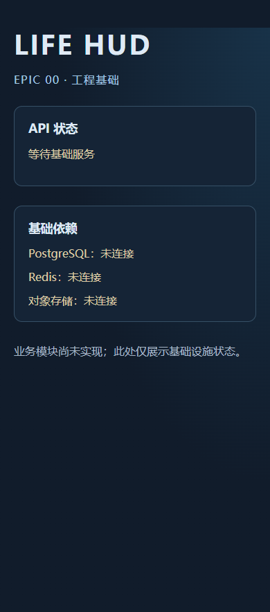

> 历史记录（已替代）：本文记录原手工 EPIC 00 方案和当时检查结果；当前以 [Ship 重建](SHIP_REBASE.md)、[开发说明](SHIP_LOCAL_DEVELOPMENT.md) 及 [验收](SHIP_REBASE_ACCEPTANCE.md) 为准。下列旧命令不再适用于活动工程。

# EPIC 00 阶段验收记录

本次用户明确启动 EPIC 00，并进一步选择“暂未安装，先完成工程与 Compose 配置”。工程与 Compose 配置部分已完成检查；完整 EPIC 00 状态保持 **IN_PROGRESS**，基础服务正向联调待 Docker 环境具备后验收。EPIC 01–13 均 **NOT_STARTED**。

## 本次实际交付

- pnpm/Turborepo 工作区，3 个应用和 7 个共享包；精确依赖与锁文件，Node 24.19.0 / pnpm 11.25.0。
- Web 工程状态页与 PWA manifest、192/512 图标、无数据缓存的导航离线提示；未实施产品导航、离线业务同步或推送。
- API/worker 实际启动基础；liveness/readiness、依赖故障处理、配置验证及进程关闭钩子。
- PostgreSQL 连接池、Redis/BullMQ infrastructure ping、S3-compatible readiness 与隔离 smoke 命令；未创建业务表、认证端点、大学实体或迁移。
- Compose 三项开发服务，精确镜像标签、loopback 端口、项目内 bind 数据目录及有限日志配置。Docker 未安装，镜像拉取和实际容器启动尚未验证。

## 实际检查结果

| 检查 | 结果 |
| --- | --- |
| 依赖安装与锁文件供应链验证 | PASS；358 条锁文件记录通过策略检查，退出码 0 |
| 生产构建 | PASS；10 个构建任务成功，包含 Next.js 生产构建、API/worker 和共享包 |
| 显式类型检查 | PASS；10 个 typecheck 任务，含依赖 build 共 14 个任务成功 |
| lint | PASS；零警告策略，退出码 0 |
| Vitest | PASS；3 个测试文件，7 项测试通过 |
| 环境生成回归 | PASS；1 项测试，验证含数字变量名及已有配置保持 |
| Edge 浏览器测试 | PASS；2 项测试，实际启动/结束隔离端口的生产 Web/API/worker |
| Compose 静态检查 | PASS；三项服务、固定镜像、loopback 端口和项目内数据目录 |
| 文档来源/阶段检查 | PASS；336 项通过，0 项失败，机器报告在项目内校验目录 |
| 文档干净副本回归 | PASS；23 项，适配 PRE_EPIC_00 和已授权 EPIC_00 状态 |
| PostgreSQL/Redis/S3 正向 roundtrip | **待验收**；本机没有 Docker，未运行服务 |

浏览器故障测试显式使用不可达的 loopback 依赖，实际验证 API/worker liveness 200、readiness 503、工程页等待状态、移动宽度无溢出、manifest/图标可访问及 service worker 注册；未用模拟成功状态替代基础服务联调。实际 `infra:smoke` 返回 PENDING_SERVICES，三个依赖均 down，退出码 1；这是未运行服务的准确结果，不计为正向通过。

## 委派与审查

浏览器测试截图已单独保存为公开工程产物，负责人目视核对等待状态、中文文字及移动布局，无工具账户或认证内容：

本地开发密码扫描核对 109 份可公开文本文件，命中 0；不打印密码值。Git 忽略规则确认 `.env`、工具状态、依赖、编译结果和测试报告被忽略。Docker 服务数据仍待实际运行验证。

Codex 负责架构/依赖/运行边界、共享配置及契约、API/worker、服务生命周期、Compose、检查与最终验收。zcode 版本验证通过，前次 HTTP 429 / 1113 资源阻塞保持记录；按用户授权改用 Qoder。

Qoder 实际生成一份固定契约下的 React 工程状态组件草稿，退出码 0；负责人检查语义结构、类型、状态文字和无业务/网络/秘密行为后整合，后续构建与浏览器验证通过。草稿没有决定架构、认证或数据库 schema。该 UI 草稿无需纠正。

本次纠正：pnpm 11 普通设置不再由 `.npmrc` 生效，迁入工作区配置并实测仓库/缓存/状态/配置目录均在项目内；安装提示 ESLint 9 停止支持，改为兼容的 ESLint 10；大包传输超时后从项目缓存续装，保持供应链/完整性检查；浏览器启动发现环境模板漏匹配含数字变量名，修正并增加回归，只补齐本次生成的空 S3 字段，保留其余配置。

## 后续验收门槛

Docker 环境具备后，按 [开发说明](EPIC_00_DEVELOPMENT.md)执行 Compose 的实际配置验证、服务启动、PostgreSQL 查询、S3 往返与 worker 队列消费；确认应用进程和服务数据路径符合项目约束后再评估 EPIC 00 完成。当前不启动 EPIC 01 或任何业务实现。
